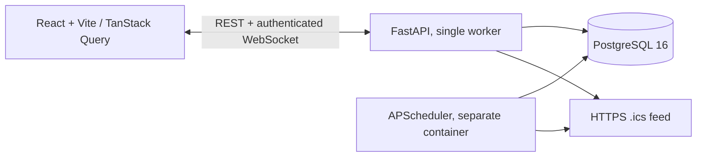
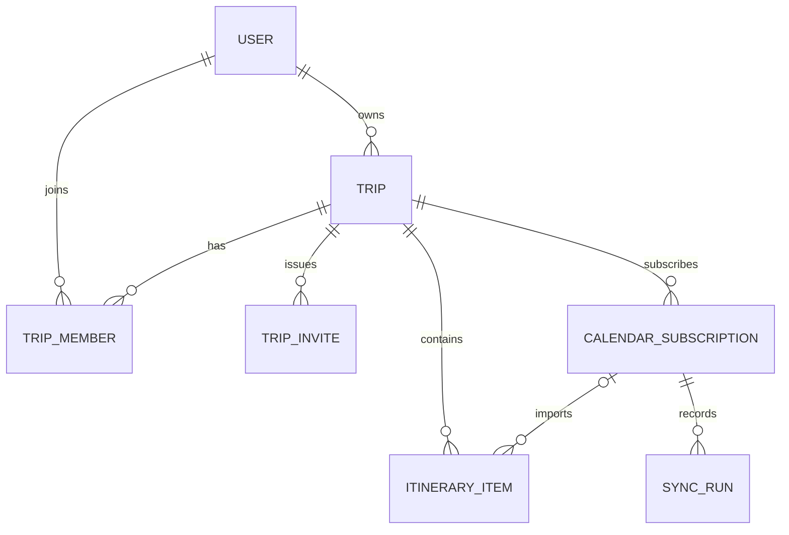

# TripSync

TripSync is a collaborative group itinerary planner where travelers share trips, invite members, and update activities with real-time browser notifications. It combines a React interface, FastAPI/PostgreSQL API, versioned activity editing, and a separate service that periodically synchronizes HTTPS iCalendar feeds, with a manual `.ics` import option.

**Project provenance:** Initial implementation: October 2026. This repository was created from a functional specification; no pre-existing TripSync code or past implementation was provided for reuse. The functionality described here is newly authored in this session, not evidence that this exact source code existed earlier. No production deployments, scale tests, or historical commits are claimed.

## Features

- Argon2 passwords, signed eight-hour HttpOnly SameSite=Lax session cookies, and CSRF header checks on authenticated mutations.
- Owner-created trips with IANA timezones, date-range validation, private single-use invitations expiring after three days, and membership-based authorization.
- Manual add/edit/delete activities, ordering, notes, optional URLs, member ownership and UTC-stored timestamps with explicit offsets.
- WebSocket events for creates, updates, deletes, trip changes and API-initiated syncs. Clients reconnect and refetch authoritative state.
- Atomic optimistic activity version checks: stale edits/deletes return HTTP 409; imported activities are read-only.
- Owner-managed remote HTTPS `.ics` subscriptions, manual `.ics` imports, 30-minute scheduled sync for remote feeds, conditional requests (ETag / Last-Modified), all-or-nothing parse/upsert/delete, failure-safe preservation of existing data, and SyncRun logs.
- Fictional Seattle demo with three travelers, six manual activities and two seeded **fixture** reservation items matching `demo/seattle.ics`. These fixtures are not remotely synchronized bookings.

## Architecture



**Important:** The scheduler persists periodic changes to PostgreSQL, but cannot publish into the API process's in-memory WebSocket hub. API-triggered sync sends `sync.completed`; for periodic changes, clients refetch the itinerary every 60 seconds or upon browser focus. Distributed WebSocket delivery requires a shared event bus and is **not implemented**.

### Entity relationships



Database tables: `users`, `trips`, `trip_members` (composite primary key), `trip_invites` (hashed secret + expiry + consumed time), `itinerary_items` (unique subscription ID + external UID, optimistic version), `calendar_subscriptions` (unique trip + URL, HTTP validators + health), and `sync_runs` (status and counts). Alembic initializes the schema. All item changes are scoped to membership and the correct trip.

## Run locally with Docker

Prerequisites: Docker Engine with Compose plugin. The following commands must be run from the repository root. Create random local secrets. Do not use the `.env.example` placeholders in a deployed environment.

```bash
cp .env.example .env
# Edit .env and set POSTGRES_PASSWORD and SESSION_SECRET to new, random values.
# SESSION_SECRET must be at least 32 characters.
docker compose up --build
```

Open **http://localhost:5173** (frontend) and **http://localhost:8000/docs** (interactive OpenAPI reference). Compose starts PostgreSQL 16, one FastAPI worker, the single APScheduler service, and Vite. Database migrations run before Uvicorn starts. The server uses HTTP-only development cookies; production deployment requires HTTPS and `COOKIE_SECURE=true` plus a correct `APP_ORIGIN`.

### Seed a two-browser demo

With the stack running:

```bash
# Choose your own temporary password; this isn't saved to the repository.
docker compose exec -e DEMO_PASSWORD="your-private-demo-password" backend python -m app.demo_seed
```

Alternatively, after `.env` is configured: `DEMO_PASSWORD="your-private-demo-password" ./demo/run.sh` starts the stack and seeds in one command. The seed is idempotent and creates a Seattle trip with three fictional accounts. Sign in as `alex@tripsync.example.test` in one normal browser and `morgan@tripsync.example.test` in a separate private/incognito browser, using the password you supplied. On the same trip, create an activity in browser A and observe browser B update; then edit the activity and observe the change. For a conflict test, begin editing the same item in both browsers, save browser A, then submit the stale edit in browser B to see HTTP 409 feedback.

To import the bundled calendar locally without any network feed, choose **Or import a local .ics file** in the UI and select `demo/seattle.ics`. This exercises the parser/upsert route; upload again to verify idempotence. The seeded reservations use the same `manual-upload` feed key, so that first upload also updates them in place without duplicates. An automatic remote sync demo requires an independently available **public HTTPS .ics URL** that passes the SSRF restrictions. Add the URL under Calendar sync, press **Sync now**, and inspect the imported items and SyncRun status. For repeatability and parser examples, see `demo/seattle.ics`; the seed inserts corresponding fictional events as **fixtures**, without accessing any external URL.

## API contract

All authenticated unsafe requests require `X-CSRF-Token` from `GET /me` in addition to the session cookie. Cookies are HttpOnly; browser JS cannot read them. Login and registration issue the cookie; fetch `/me` immediately afterward. No third-party credentials are needed.

| Method | Route | Purpose / authorization |
|---|---|---|
| POST | `/auth/register`, `/auth/login` | Create/login; set session cookie |
| POST | `/auth/logout` | Clear session, signed-in user + CSRF |
| GET | `/me` | User and per-session CSRF token |
| GET, POST | `/trips` | List member trips / create owner trip |
| GET, PATCH, DELETE | `/trips/{trip_id}` | Member read / owner update-delete |
| POST | `/trips/{trip_id}/invites` | Owner creates one-use 3-day invite |
| POST | `/invites/{token}/accept` | Signed-in nonmember consumes invite |
| GET, POST | `/trips/{trip_id}/items` | Member list/create items |
| PATCH | `/trips/{trip_id}/items/{item_id}` | Member edits manual item; JSON `version` required |
| DELETE | `/trips/{trip_id}/items/{item_id}?version=N` | Member deletes manual item; version required |
| GET, POST | `/trips/{trip_id}/calendar-subscriptions` | Member list / owner subscribe |
| PUT | `/trips/{trip_id}/calendar-import/{feed_name}` | Owner imports complete `text/calendar` body; stable named fixture feed |
| POST | `/trips/{trip_id}/sync` | Owner triggers remote feed syncs |
| GET | `/trips/{trip_id}/sync-runs` | Member views latest 100 runs |
| WS | `/ws/trips/{trip_id}` | Member-only cookie authorization and Origin check |

**Request example** (after a successful login, with cookie in `cookies.txt`):

```bash
curl -b cookies.txt http://localhost:8000/me
curl -b cookies.txt -H 'X-CSRF-Token: <token from /me>' -H 'Content-Type: application/json' \
  -d '{"title":"Explore Seattle","starts_at":"2026-11-02T09:00:00-08:00","ends_at":"2026-11-02T10:00:00-08:00","location":"Pike Place Market"}' \
  http://localhost:8000/trips/1/items
```

WebSocket event bodies include `type`, `trip_id`, and, for item changes, `item_id`, `version`, `fields`; `trip.updated` includes updated fields and `sync.completed` includes `subscription_id`, `run_id`, `status`, and counts. The client refetches after events rather than treating them as unconditional last-write-wins patches.

## Automated checks

```bash
# Set up Python 3.12 with the pinned dependencies (inside backend/):
cd backend
python -m pip install -r requirements-dev.txt
python -m pytest tests -q
python -m compileall -q app
ruff check app tests
alembic upgrade head

# Separate terminal, repository root:
cd frontend
npm install
npm run typecheck
npm run build
```

GitHub Actions `.github/workflows/ci.yml` runs backend tests/lint/migration and frontend typecheck/build. See the separate execution evidence provided with the handoff for which commands actually ran in the authoring environment; the existence of CI config does **not** establish a successful GitHub run.

## Security, privacy and operational limitations

- HTTPS URL hostnames only, default port 443, no URL credentials, redirects or proxy environment; DNS resolution must yield only public addresses and the IP is pinned to TLS with hostname SNI. Responses are limited to 1 MiB. Private, loopback, link-local, and cloud metadata addresses are rejected. **Live external TLS / DNS-rebinding integration has not been exercised from the authoring environment.**
- Uploaded local calendars are managed separately from the remote scheduler and can be replaced by re-uploading the same feed name. The calendar parser rejects unsupported recurring VEVENTs instead of partially importing them. A failed fetch or parse preserves all previous imports and every manual activity. This initial version does not support OAuth calendar providers, authenticated feeds, recurring event expansion, timezone-free calendar events, or multi-feed event deduplication beyond each source UID.
- Passwords are stored as Argon2 hashes. Signed cookie sessions are stateless: logout clears the browser cookie but cannot independently revoke a stolen token until expiry. Add server-side revocation and login rate limiting before production deployment. Use a reverse proxy for HTTPS.
- `POST /trips/{id}/sync` performs work in the API process, can be slow for large feeds, and retries transient fetch errors twice with bounded backoff, while other failures wait for the next job. Scheduler and manual sync lack distributed locking; run only one scheduler, and use a queue/locking for production.
- For exact daylight-saving transitions, the activity form asks for an explicit ISO-8601 UTC offset. Display and grouping use the trip's IANA timezone. Ambiguous wall times are therefore user-resolved, not guessed.
- No network benchmarks, screenshots, browser recordings, PostgreSQL integration run, Docker Compose run, or remote-GitHub CI success are represented without independent execution evidence.
- This repository intentionally has **no license file** pending the owner's decision. Do not publish before approval.

See [engineering decisions](docs/engineering-decisions.md) for architecture tradeoffs.

**Dependency reproducibility caveat:** Direct Python and JavaScript dependencies are version-pinned. A complete transitive npm lockfile has not been generated because package-registry access was unavailable during this session; run `npm install` and commit the resulting `package-lock.json` before treating frontend builds as fully reproducible.
